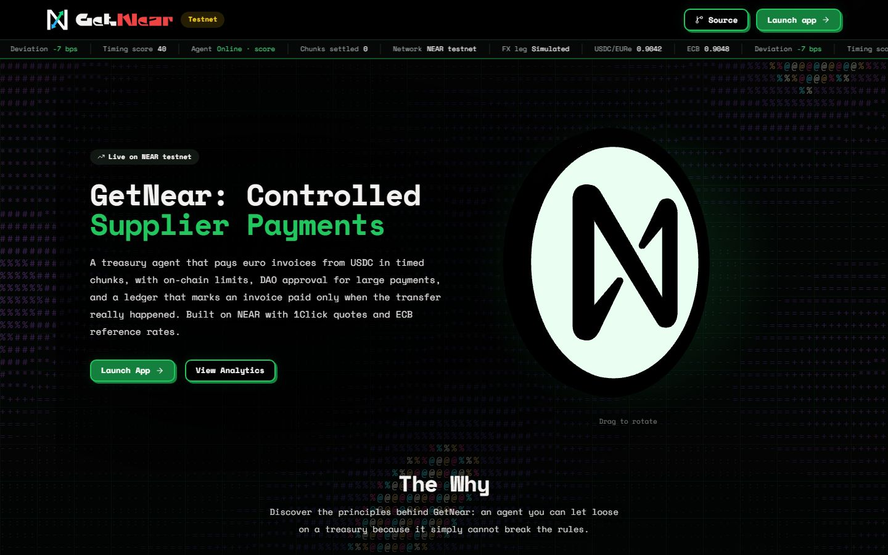
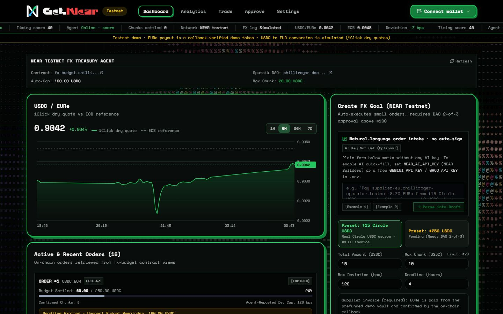
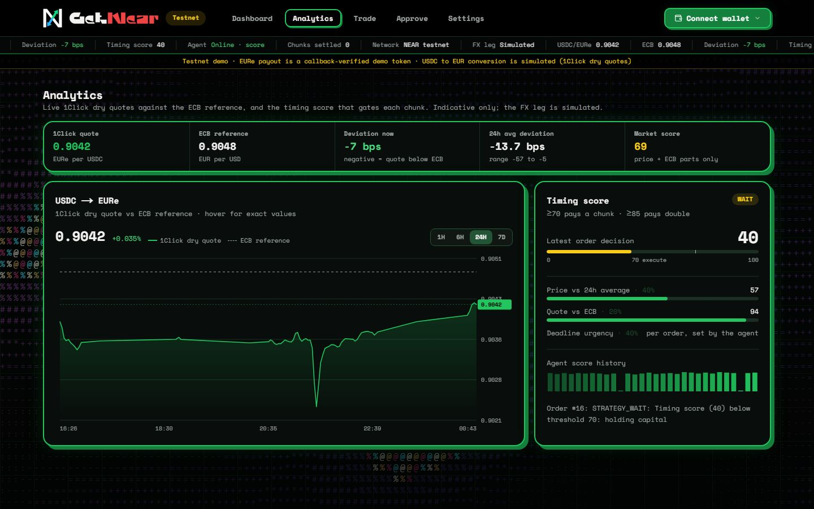
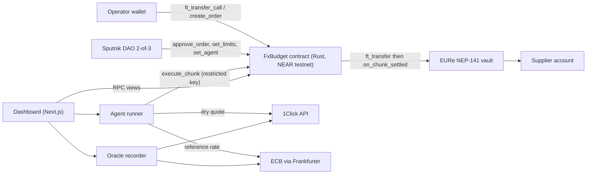

# GetNear

**Controlled supplier payments on NEAR testnet: an autonomous treasury agent that can only do what an on-chain contract allows.**


| | |
| :-- | :-- |
| **Live demo** | https://getnear-psi.vercel.app (testnet; read-only without a wallet) |
| **Repository** | https://github.com/ChilliRoger/GetNear |
| **Built for** | NEAR HACKATHON. Tracks: Real-World Money (`realworld`), Autonomous Business (`business`), AI Security & Defense (`security`) |
| **Status** | Testnet only. No mainnet funds, no mainnet deployment. The USDC to EUR conversion is simulated (see [What is real vs simulated](#what-is-real-vs-simulated)). |



## Contents
1. [The problem](#the-problem) · 2. [What GetNear does](#what-getnear-does) · 3. [Try it in 2 minutes](#try-it-in-2-minutes) · 4. [How NEAR is used](#how-near-is-used)
5. [Architecture](#architecture) · 6. [What is real vs simulated](#what-is-real-vs-simulated) · 7. [How a payment flows](#how-a-payment-flows) · 8. [Evidence](#evidence-on-testnet)
9. [Run it locally](#run-it-locally) · 10. [Repository layout](#repository-layout) · 11. [Hackathon disclosures](#hackathon-disclosures) · 12. [Security and limitations](#security-and-limitations) · 13. [Documentation](#documentation) · 14. [License](#license-and-credits)

## The problem
A treasury owes a euro supplier an invoice but holds USDC. Doing this safely needs four things at once:
1. human, multi-signer approval for large payments;
2. an automated agent that can pay **only that supplier, only up to the invoice amount, only inside limits it cannot change**;
3. retries that can never pay twice;
4. a ledger that marks the invoice paid **only when the transfer really happened**.

Today teams either convert manually, convert everything in one trade at whatever rate is live, or hand an agent too much authority.

## What GetNear does
- **Invoice orders.** An order carries a supplier account, an invoice target in EURe (`target_out`), a USDC budget, a max chunk size, a deadline and a max price deviation.
- **On-chain limits.** The Rust `FxBudget` contract enforces max chunk, total budget, deadline, minimum interval and a payout bound (the invoice target). The agent cannot exceed them.
- **DAO approval.** Orders above the auto-cap ($100) stay `Pending` until a Sputnik DAO council approves them (2 of 3). The DAO also owns the contract (limits, agent, pause).
- **Restricted agent key.** The agent signs with a function-call access key limited to the single method `execute_chunk`. It cannot approve, expire, change limits or call other contracts.
- **Callback-verified settlement.** `execute_chunk` reserves the chunk, sends demo EURe to the supplier with a cross-contract `ft_transfer`, and reduces the amount due **only inside the `#[private] on_chunk_settled` callback** after the transfer succeeded. A failed transfer leaves the invoice due unchanged and the chunk retryable. An on-chain idempotency record (`InFlight | Settled | Failed`) means a retry can never pay twice.
- **Timed chunks.** The agent scores live 1Click dry quotes against the ECB reference rate and the deadline (price vs average 40%, quote vs ECB 20%, deadline urgency 40%). Score 70+ pays a chunk, 85+ pays double, below 70 it waits. Hard guards (deviation limit, interval, contract caps) always apply. This is a timing heuristic, not a claim of better rates.
- **Escrow and refunds.** Orders can be funded with Circle testnet USDC via `ft_transfer_call`; unspent escrow is refundable. The final chunk is sized so the USDC charged matches the amount actually paid.
- **Dashboard.** Live rate vs ECB, rate history, an agent decision feed, on-chain orders, DAO proposals and voting, natural-language order intake (optional), every transaction linked on NEARBlocks.

| Dashboard | Analytics |
| :-- | :-- |
|  |  |

## Try it in 2 minutes
No wallet, key or account is needed for steps 1 to 4.

1. **Open the live app:** https://getnear-psi.vercel.app. The rate bar shows the live USDC/EURe 1Click dry quote next to the ECB reference rate and their deviation in bps.
2. **See an on-chain invoice settle:** on the landing page open *Live, not mocked → Order #13*. It links the three NEARBlocks transactions: escrow funding, the final `execute_chunk` (+€5.00 demo EURe), and the refund of unspent escrow.
3. **Read the contract state:** open `/dashboard`. *Active & Recent Orders* is read straight from the `FxBudget` contract over RPC (16 orders, with invoice targets, settled amounts, chunk counts and statuses). `/approve` lists the Sputnik DAO proposals and their votes.
4. **Verify the evidence yourself against the chain** (read-only, ~1 minute, Node 20.19+/22/24, pnpm 12):
   ```bash
   pnpm install --frozen-lockfile
   pnpm verify:readonly
   ```
   Expected: `PASS 86  FAIL 0  RPC_ERROR 0`, exit code `0`. It checks the deployed contract code hash against the bundled artifact, Orders #8, #11, #12 (historical, previous build), the Order #12 escrow reconciliation and the fresh invoice Order #13 (`--expect-upgraded --expect-fresh` makes the upgraded build mandatory).
5. **Run the contract tests** (needs Rust): `cd contracts/fx-budget && cargo test --locked --lib` runs 15 unit tests in near-sdk's mock VM (payout bounds, adjusted escrow debit, failed-callback accounting, idempotent retry, refund rollback, state migration).
6. **Run everything locally** (dashboard, oracle, agent): see [Run it locally](#run-it-locally).

> **Creating an order with your own wallet** requires your account to be an authorized requester on the contract (the DAO runs `add_requester`). Orders are deliberately not open to arbitrary wallets: without authorization the escrow is refunded and no order is created. The captured orders above are the demonstration; they were created by the team's authorized accounts.

## How NEAR is used
| NEAR feature | Where |
| :-- | :-- |
| Rust smart contract (near-sdk 5) | `contracts/fx-budget`: orders, limits, escrow, idempotent chunk records, refunds, events (NEP-297) |
| Sputnik DAO v2 (2-of-3) | Contract owner: approves large orders, sets limits and the agent, can pause |
| Function-call access keys | The agent's key is restricted to `execute_chunk` with no deposit allowance |
| NEP-141 + cross-contract calls + callbacks | `ft_transfer` payout and `#[private] on_chunk_settled`; `ft_on_transfer` receiver for Circle USDC escrow |
| JSON-RPC | `packages/near-client` (failover across public RPCs); dashboard reads contract views |
| near-cli-rs | The agent signs `execute_chunk` with the restricted key file |
| NEAR wallet selector | Meteor, Here, MyNearWallet and Sender sign orders and DAO votes |
| NEAR Intents / 1Click API | Read-only `dry: true` quotes (no execution). NEAR Intents has no testnet. |
| NEAR AI Cloud (optional) | Natural-language order intake, with Gemini / Groq fallbacks. The form works without any key. No private-inference claim is made. |

## Architecture


**Trust model (what is enforced by what):**

| Property | Enforced by | Strength |
| :-- | :-- | :-- |
| Only the DAO approves large orders or changes limits | Contract owner check | On-chain, hard |
| Agent can call only `execute_chunk` | Access-key restriction | Protocol, hard |
| Max chunk, total, deadline, minimum interval, payout bound | Contract | On-chain, hard |
| Invoice balance reduction | Cross-contract `ft_transfer` + `on_chunk_settled` callback | On-chain, hard |
| Chunk retry cannot double-pay | On-chain idempotency record | On-chain, hard |
| Price deviation limit | Agent-reported `deviation_bps` | Policy check, **not** oracle-verified |
| Quote authenticity | Nothing | Not verified |
| USDC to EUR conversion | 1Click `dry: true` accounting | **Simulated** |

## What is real vs simulated
| # | Fact | Status |
| :-: | :-- | :-- |
| 1 | Live 1Click dry quote (`dry: true`) next to the ECB / Frankfurter reference rate | Real data, **indicative only**: nothing is executed |
| 2 | USDC to EUR conversion | **Simulated.** No cross-chain swap happens; NEAR Intents has no testnet |
| 3 | Circle testnet USDC escrow (`3e2210e1…b8af`) funded with `ft_transfer_call` | Real testnet tokens locked in `FxBudget`; unspent USDC is refundable |
| 4 | Demo EURe payout from a prefunded vault (`eure.chilliroger-operator.testnet`) to the supplier | Real NEP-141 transfer on testnet, confirmed by the callback. EURe is a **team-minted demo token** and the "supplier" is a sub-account of the operator |

The README, UI and agent logs label simulated parts as simulated. GetNear makes no savings, mainnet or privacy claims.

## How a payment flows
1. **Create and fund.** `ft_transfer_call` of Circle USDC (or accounting-only `create_order`). Every order carries an invoice target that bounds its payouts on-chain.
2. **Approve.** Above the $100 auto-cap the order is `Pending` until the DAO approves (2 of 3).
3. **Quote.** The agent reads a live dry quote and the ECB rate and applies the deviation policy and the timing score.
4. **Size.** If the remaining invoice is below the quoted output, the payout is clamped and the USDC charged is reduced to `ceil(remainingOut × quotedIn / quotedOut)`.
5. **Persist, then broadcast.** The attempt is stored in SQLite, then `execute_chunk` is sent with the restricted key.
6. **Callback.** `FxBudget` transfers demo EURe; `on_chunk_settled` updates `settled_out` and `executed_in` only on success.
7. **Reconcile.** The agent verifies on-chain state (at startup and for closed orders); the dashboard reads the contract.
8. **Refund.** After `Completed`, `Cancelled` or `Expired`, `refund_unused_escrow` returns unspent USDC (a requester-signed call).

"Paid" means the amount due is **zero**. If the USDC budget runs out first the dashboard shows "Budget exhausted · €X still due".

## Evidence on testnet
| Item | Link |
| :-- | :-- |
| FxBudget contract (upgraded build, code sha256 `0bd18830…7d2fec`) | [`fx-budget.chilliroger-operator.testnet`](https://testnet.nearblocks.io/address/fx-budget.chilliroger-operator.testnet) |
| Sputnik DAO (owner, 2-of-3) | [`chilliroger-dao.sputnik-v2.testnet`](https://testnet.nearblocks.io/address/chilliroger-dao.sputnik-v2.testnet) |
| Agent account (restricted `execute_chunk` key) | `chilliroger-agent.testnet` |
| **Order #13** funding (`ft_transfer_call`, $10 Circle USDC) | [tx](https://testnet.nearblocks.io/txns/ZnaHzUsMawWiTTAa5RrbfqTeQQqyhn8vY6tb41b7nMd) |
| Order #13 final `execute_chunk` (+€5.00 demo EURe, USDC charge recalculated to $5.541224) | [tx](https://testnet.nearblocks.io/txns/6eAGwbnBR8X5Q72J8kf8tPMPaChHSJ5Ma9zmBmzLM7of) |
| Order #13 `refund_unused_escrow` ($4.458776 returned) | [tx](https://testnet.nearblocks.io/txns/63pmWkCcViJShmXwgwELG5uUTbn5TBCRAHjv7Di2pFha) |

Full tables (Orders #8, #11, #12, the changes since them, and what each verification layer proves): **[docs/EVIDENCE.md](docs/EVIDENCE.md)**.

## Run it locally
Requirements: **Node 20.19+, 22 or 24** and **pnpm 12.18** (`npm i -g pnpm@12.18.0`). Rust and `near-cli-rs` are only needed for contract tests and for the agent to sign.

```bash
git clone https://github.com/ChilliRoger/GetNear.git && cd GetNear
pnpm install --frozen-lockfile
cp .env.example .env                       # testnet defaults; no secrets needed to read

pnpm --filter @getnear/oracle dev          # 1) price recorder      http://localhost:38174
pnpm agent:start                           # 2) agent loop + API    http://127.0.0.1:38175 (submitting needs the restricted key file)
pnpm --filter @getnear/app dev             # 3) dashboard           http://localhost:3100
```
The dashboard works read-only without any credentials. If the oracle or agent is not running it says so instead of inventing data (the headline rate still loads live; the chart then builds from live samples in your browser).

```bash
pnpm lint            # ESLint + type checks across the workspace
pnpm test            # shared, near-client, agent, dashboard security, script-argument tests
pnpm --filter @getnear/app build
pnpm test:contract:rust    # Rust unit tests (needs Rust)
```
Optional: `AGENT_STRATEGY=immediate` makes the agent pay as soon as guards pass (handy for short demos); the default `score` mode gates every chunk by the timing score. Mainnet is refused unless `ALLOW_MAINNET=1` (nothing is deployed on mainnet). Configuration reference: [docs/CONFIG.md](docs/CONFIG.md). Deployment (Vercel, Oracle Cloud VM, Cloudflare Tunnel): [docs/DEPLOYMENT.md](docs/DEPLOYMENT.md).

## Repository layout
```
contracts/fx-budget/   Rust FxBudget contract, unit tests, reproducible WASM artifacts
apps/app/              Next.js 14 dashboard (landing, dashboard, analytics, trade, approve, settings)
apps/agent/            Agent runner: attempt persistence, reconciliation, read-only HTTP API (SQLite)
apps/oracle/           Read-only market recorder (1Click dry quotes + ECB) and market-score endpoint
apps/faucet/           Demo-token faucet (separate Next.js app)
packages/shared/       Domain types, strategy engine, chunk sizing, 1Click and Frankfurter sources, config
packages/near-client/  JSON-RPC client with failover
scripts/               Deployment, verification and drill scripts (testnet), read-only verifier
deploy/vm/             systemd + setup script for hosting the oracle and agent on a small VM
docs/                  Contract spec, security model, strategy, evidence, deployment, audit
```

## Hackathon disclosures
**Built during the hackathon window (2026-11-01 to 2026-11-14).** The first commit in this repository is from 2026-11-06.

**Baseline / existing project on another chain.** The repository started from an imported upstream project, **Meridian FX** by Team Ippo, built for ETHGlobal Cannes 2026 on Base, Arc, Uniswap, Chainlink CRE, World ID and Unlink. Its imported state is tagged **`pre-hackathon`** (commit `75e48c2`, upstream moved to the repository root, unmodified). Everything after it is the NEAR work. Diff: https://github.com/ChilliRoger/GetNear/compare/pre-hackathon...hackathon-submission

| Kept from the upstream baseline (adapted) | Written for this hackathon |
| :-- | :-- |
| Monorepo scaffold (pnpm + Turborepo), Next.js app skeleton, Hono + SQLite oracle skeleton | The `FxBudget` Rust contract (orders, limits, escrow, callback-verified settlement, idempotency, refunds, migrations) and its tests |
| Timing-score and adaptive-TWAP strategy concept (re-implemented against 1Click + ECB and shared by the oracle and agent) | The agent runner (restricted key, durable attempts, reconciliation, recovery drills) |
| | Sputnik DAO deployment, bootstrap and voting flow; NEAR RPC client; wallet integration |
| | Invoice model, escrow with Circle USDC, final-chunk sizing, demo EURe/USDC tokens, verifier and evidence tooling |
| | The complete redesigned dashboard, natural-language intake, security guards and tests |

All EVM code (Solidity contracts, Chainlink CRE, World ID, Unlink, Arc and Base configuration) was removed; see [docs/AUDIT.md](docs/AUDIT.md).

**Libraries, templates and AI-written code.**
- *Frontend:* Next.js 14, React 18, Tailwind CSS, lucide-react, `@near-wallet-selector/*` (core, modal-ui, meteor-wallet, here-wallet, my-near-wallet, sender), three.js (3D NEAR token), Lenis (smooth scroll), `ascii-magic-art` (MIT, hero animation).
- *Services:* Hono, `@hono/node-server`, `better-sqlite3`, zod, tsx, Turborepo, TypeScript.
- *Contract:* Rust, `near-sdk` 5.7, `serde`.
- *External services (read-only):* 1Click API (`dry: true`), Frankfurter (ECB rates), public NEAR RPC endpoints, optional NEAR AI Cloud / Google Gemini / Groq for intake.
- *Fonts and assets:* Space Mono (Google Fonts, OFL); the "GetNear" wordmark is rendered with a licensed font and shipped as an image; the NEAR 3D model is the team's own GLB.
- **AI-assisted development.** Most of the code, tests and documentation in this repository were written with **Claude Code** (Anthropic) under the developer's direction and review, including the Rust contract, the agent, the dashboard and this README. Tests, linting, a production build and the read-only on-chain verifier were run to check it.

**Other disclosures.** No NEAR Intents JWT is used (quotes are `dry: true`). The only contact with a mainnet service is read-only HTTPS to the 1Click quote API. No mainnet account, key or funds are used.

## Security and limitations
Trust model and key inventory: [docs/SECURITY.md](docs/SECURITY.md). Pre-deployment audit: [docs/AUDIT.md](docs/AUDIT.md).
- The USDC to EUR conversion is simulated; `deviation_bps` is **agent-reported**, not oracle-verified; quote authenticity is not verified.
- `FullAccess` keys still exist on the contract and agent accounts (a testnet shortcut); remove or DAO-gate upgrades before anything beyond a demo.
- Retained input USDC has no withdrawal path; never-approved `Pending` escrow orders are not auto-expired; refunds are a manual, requester-signed call.
- `settlement_out` is not tied to `amount_in` on-chain: a compromised agent key could over-charge USDC within the chunk cap and budget, and pay at most the invoice target.
- Public RPC endpoints can rate-limit (HTTP 429); the clients retry and fail over.
- The hosted dashboard shows recorded history and the agent feed only while the oracle and agent services are reachable (they run outside Vercel).

**Roadmap (not shipped):** mainnet deployment with real stablecoin rails, an on-chain price oracle for the deviation check, supplier allow-lists, owner-only withdrawal of retained input, removal of `FullAccess` keys.

## Documentation
| Doc | What it covers |
| :-- | :-- |
| [docs/CONTRACT.md](docs/CONTRACT.md) | `FxBudget` state, methods, events, upgrade and migration notes |
| [docs/STRATEGY.md](docs/STRATEGY.md) | Timing score, adaptive TWAP, guards and honest limitations |
| [docs/SECURITY.md](docs/SECURITY.md) | Who controls what, server-side surfaces, recovery guarantees |
| [docs/EVIDENCE.md](docs/EVIDENCE.md) | Testnet transactions and what each check proves |
| [docs/CONFIG.md](docs/CONFIG.md) | Environment variables |
| [docs/DEPLOYMENT.md](docs/DEPLOYMENT.md), [docs/ORACLE_CLOUD.md](docs/ORACLE_CLOUD.md) | Vercel, hosting the oracle and agent |
| [docs/AUDIT.md](docs/AUDIT.md) | Pre-deployment audit |
| [docs/FAILURE_DRILLS.md](docs/FAILURE_DRILLS.md), [docs/UPGRADE_AND_FRESH_INVOICE.md](docs/UPGRADE_AND_FRESH_INVOICE.md) | Failure drills and the upgrade runbook |

## License and credits
MIT, see [LICENSE](LICENSE). Credits and upstream attribution: [NOTICE.md](NOTICE.md). Meridian FX by Team Ippo (ETHGlobal Cannes 2026) is the upstream baseline described above. ASCII art by [ASCII Magic](https://www.ascii-magic.com/ascii) (MIT).
