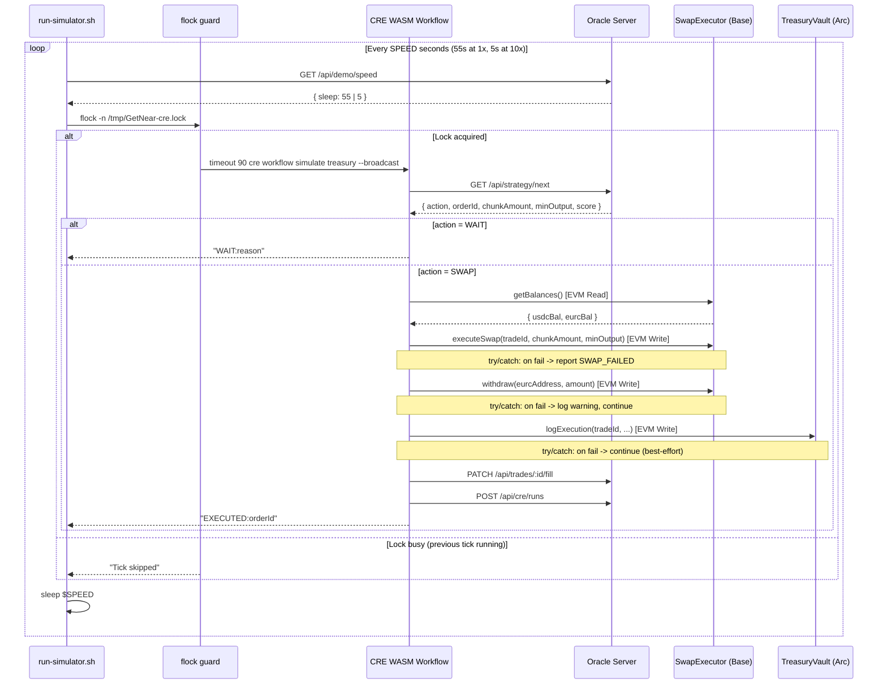
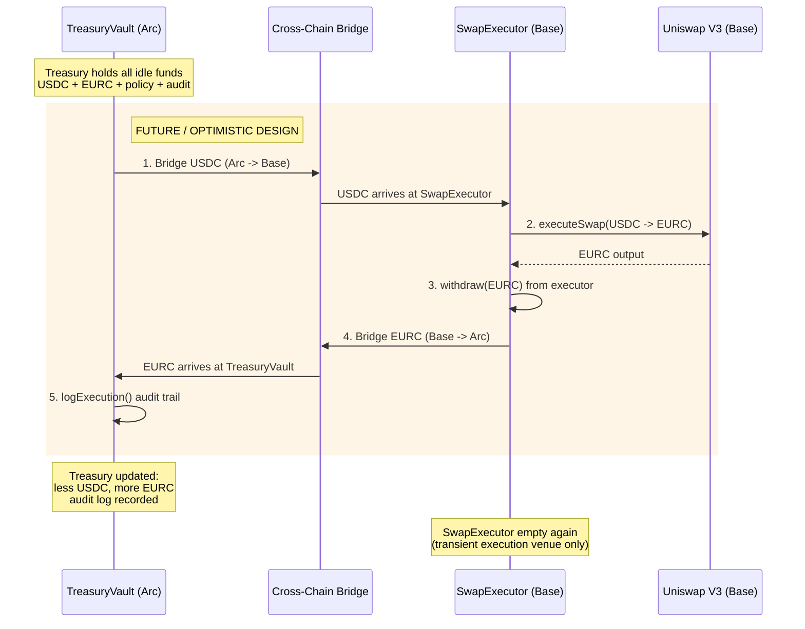

# System Overview — CRE Workflow Loop

The CRE simulator runs as a bash loop. Each iteration ("tick") asks the Oracle
what to do, optionally executes a swap, and reports results back.

## Diagram 1: CRE Workflow Loop

### ASCII Art

```
  ┌─────────────────────────────────────────────────────────────────────────┐
  │                       run-simulator.sh  (bash loop)                     │
  │                                                                         │
  │  while true; do                                                         │
  │    ┌──────────────────────────────────────────────┐                     │
  │    │  curl Oracle /api/demo/speed -> SPEED (55|5) │                     │
  │    └──────────────────┬───────────────────────────┘                     │
  │                       │                                                 │
  │                       v                                                 │
  │    ┌──────────────────────────────────────────────────────────────┐     │
  │    │  flock -n /tmp/GetNear-cre.lock                             │     │
  │    │  (skip tick if previous still running)                       │     │
  │    │                                                              │     │
  │    │  timeout 90                                                  │     │
  │    │  cre workflow simulate treasury --broadcast                  │     │
  │    │  ┌─────────────────────────────────────────────────────────┐ │     │
  │    │  │             CRE WASM Workflow (workflow.ts)              │ │     │
  │    │  │                                                         │ │     │
  │    │  │  1. HTTP GET /api/strategy/next ──────────> Oracle      │ │     │
  │    │  │     │                                                   │ │     │
  │    │  │     ├── action: WAIT ──> return "WAIT:reason"           │ │     │
  │    │  │     │                                                   │ │     │
  │    │  │     └── action: SWAP                                    │ │     │
  │    │  │         │                                               │ │     │
  │    │  │         v                                               │ │     │
  │    │  │  2. EVM Read: SwapExecutor.getBalances()  (Base 8453)   │ │     │
  │    │  │     │  sanity check: USDC >= chunkAmount?               │ │     │
  │    │  │     │                                                   │ │     │
  │    │  │     v                                                   │ │     │
  │    │  │  3. EVM Write: SwapExecutor.executeSwap()  (Base 8453)  │ │     │
  │    │  │     │  try/catch: on fail -> report SWAP_FAILED, exit   │ │     │
  │    │  │     │                                                   │ │     │
  │    │  │     v                                                   │ │     │
  │    │  │  4. EVM Write: SwapExecutor.withdraw()  (Base 8453)     │ │     │
  │    │  │     │  try/catch: on fail -> log warning, continue      │ │     │
  │    │  │     │  (funds safe in executor)                         │ │     │
  │    │  │     │                                                   │ │     │
  │    │  │     v                                                   │ │     │
  │    │  │  5. EVM Write: TreasuryVault.logExecution()  (Arc 5042) │ │     │
  │    │  │     │  try/catch: on fail -> continue (best-effort)     │ │     │
  │    │  │     │                                                   │ │     │
  │    │  │     v                                                   │ │     │
  │    │  │  6. HTTP PATCH /api/trades/:id/fill ──────> Oracle      │ │     │
  │    │  │     HTTP POST  /api/cre/runs ─────────────> Oracle      │ │     │
  │    │  │     return "EXECUTED:orderId"                            │ │     │
  │    │  └─────────────────────────────────────────────────────────┘ │     │
  │    └──────────────────────────────────────────────────────────────┘     │
  │                       │                                                 │
  │                       v                                                 │
  │    ┌──────────────────────────────────────────────┐                     │
  │    │  tee -a /tmp/cre-loop.log                    │                     │
  │    │  sleep $SPEED                                │                     │
  │    └──────────────────┬───────────────────────────┘                     │
  │                       │                                                 │
  │                       └───────> (loop back to top)                      │
  └─────────────────────────────────────────────────────────────────────────┘
```

### Mermaid



---

## Diagram 1B: Extended CRE with Post-Swap Bridging (Optimistic/Future)

Shows how CRE would be extended to manage cross-chain bridging so that treasury
funds live on Arc by default and only move to Base for active swap execution.

**Status: FUTURE / OPTIMISTIC DESIGN -- not yet implemented.**

### ASCII Art

```
  ┌─────────────────────────────────────────────────────────────────────────┐
  │  FUTURE CRE WORKFLOW: Cross-Chain Bridging                              │
  │                                                                         │
  │  Arc (Chain 5042002)                   Base (Chain 8453)                │
  │  ┌───────────────────────┐             ┌───────────────────────┐       │
  │  │    TreasuryVault      │             │    SwapExecutor       │       │
  │  │  ┌─────────────────┐  │             │  ┌─────────────────┐  │       │
  │  │  │  USDC (idle)    │  │             │  │  (empty)        │  │       │
  │  │  │  EURC (idle)    │  │             │  │                 │  │       │
  │  │  │  Policy config  │  │             │  │  Uniswap V3     │  │       │
  │  │  │  Audit logs     │  │             │  │  SwapRouter     │  │       │
  │  │  └─────────────────┘  │             │  └─────────────────┘  │       │
  │  └───────────┬───────────┘             └───────────┬───────────┘       │
  │              │                                     │                    │
  │              │  STEP 1: Bridge USDC                │                    │
  │              │  Arc -> Base                         │                    │
  │              ├─────────────────────────────────────>│                    │
  │              │                                     │                    │
  │              │               STEP 2: Execute Swap  │                    │
  │              │               SwapExecutor calls     │                    │
  │              │               Uniswap V3             │                    │
  │              │                  ┌───────────────┐   │                    │
  │              │                  │ USDC -> EURC  │   │                    │
  │              │                  │ exactInput    │   │                    │
  │              │                  │ Single()      │   │                    │
  │              │                  └───────────────┘   │                    │
  │              │                                     │                    │
  │              │               STEP 3: Withdraw EURC │                    │
  │              │               from SwapExecutor      │                    │
  │              │                                     │                    │
  │              │  STEP 4: Bridge EURC                │                    │
  │              │  Base -> Arc                         │                    │
  │              │<─────────────────────────────────────┤                    │
  │              │                                     │                    │
  │              v                                     v                    │
  │  ┌───────────────────────┐             ┌───────────────────────┐       │
  │  │    TreasuryVault      │             │    SwapExecutor       │       │
  │  │  ┌─────────────────┐  │             │  ┌─────────────────┐  │       │
  │  │  │  USDC (less)    │  │             │  │  (empty again)  │  │       │
  │  │  │  EURC (more)    │  │             │  │                 │  │       │
  │  │  │  + audit log    │  │             │  │                 │  │       │
  │  │  └─────────────────┘  │             │  └─────────────────┘  │       │
  │  └───────────────────────┘             └───────────────────────┘       │
  │                                                                         │
  │  KEY: Arc = "home base" (security + audit)                              │
  │       Base = "execution venue" (transient, only during active swap)     │
  └─────────────────────────────────────────────────────────────────────────┘
```

### Mermaid


