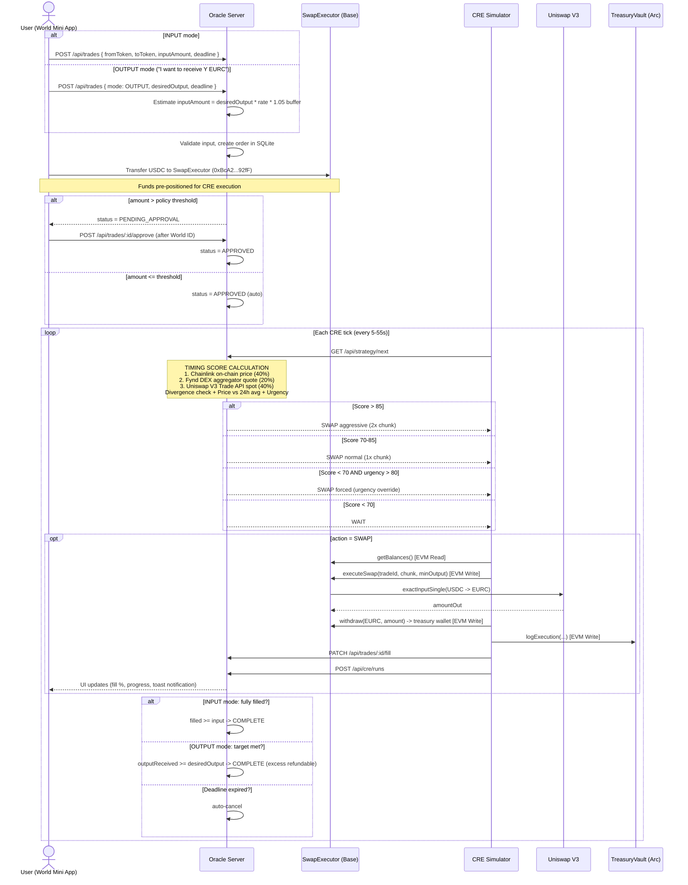

# Trade Decision Flow (Detailed)

Full swim-lane sequence from user trade submission through execution.
Supports two modes: **INPUT mode** ("I want to spend X USDC") and
**OUTPUT mode** ("I want to receive Y EURC").

### ASCII Art

```
  USER (World Mini App)         ORACLE SERVER              CRE SIMULATOR           CONTRACTS
  ─────────────────────         ──────────────             ─────────────           ─────────
         │                            │                          │                      │
    1a.  │  INPUT MODE                │                          │                      │
         │  POST /api/trades          │                          │                      │
         │  { fromToken: USDC,        │                          │                      │
         │    toToken: EURC,          │                          │                      │
         │    inputAmount, deadline } │                          │                      │
         ├───────────────────────────>│                          │                      │
         │                            │                          │                      │
    1b.  │  OUTPUT MODE               │                          │                      │
         │  POST /api/trades          │                          │                      │
         │  { fromToken: USDC,        │                          │                      │
         │    toToken: EURC,          │                          │                      │
         │    mode: "OUTPUT",         │                          │                      │
         │    desiredOutput, deadline }│                          │                      │
         ├───────────────────────────>│                          │                      │
         │                            │                          │                      │
    2.   │                    Validate input,                    │                      │
         │                    create order in SQLite             │                      │
         │                    ┌────────────────────────┐         │                      │
         │                    │ OUTPUT mode?            │         │                      │
         │                    │  YES -> Oracle estimates │         │                      │
         │                    │  inputAmount from        │         │                      │
         │                    │  Chainlink price + 5%    │         │                      │
         │                    │  buffer                  │         │                      │
         │                    │  NO -> use inputAmount   │         │                      │
         │                    └────────────────────────┘         │                      │
         │                            │                          │                      │
    3.   │  User transfers USDC to    │                          │                      │
         │  SwapExecutor contract     │                          │                      │
         │  0xBcA2...92fF                                       │                      │
         │  (funds pre-positioned     │                          │                      │
         │   for CRE execution)       │                          │                      │
         │────────────────────────────┼──────────────────────────┼──────────────────────>│
         │                            │                          │                      │
    4.   │                    ┌───────┴────────┐                 │                      │
         │                    │ amount > policy │                 │                      │
         │                    │ threshold?      │                 │                      │
         │                    └───┬─────────┬──┘                 │                      │
         │                   YES  │         │  NO                │                      │
         │                        v         v                    │                      │
         │               status =       status =                 │                      │
         │               PENDING_       APPROVED                 │                      │
         │               APPROVAL       (auto)                   │                      │
         │                    │              │                    │                      │
         │<───────────────────┤              ├──────────────────> │  enters execution    │
         │ "needs approval"   │              │                    │  queue               │
         │                    │              │                    │                      │
    5.   │  World ID verify   │              │                    │                      │
         │  POST /api/trades/ │              │                    │                      │
         │    :id/approve     │              │                    │                      │
         ├───────────────────>│              │                    │                      │
         │               status = APPROVED   │                    │                      │
         │                    ├──────────────>│  enters execution  │                      │
         │                    │              │  queue              │                      │
         │                    │              │                    │                      │
  ═══════╪════════════════════╪══════════════╪════════════════════╪══════════════════════╪═══
         │                    │         EACH CRE TICK            │                      │
         │                    │              │                    │                      │
    6.   │                    │<─────────────┤ GET /api/strategy/ │                      │
         │                    │              │     next           │                      │
         │                    │              │                    │                      │
         │            ┌───────┴──────────────┴────────────────────┐                     │
         │            │  TIMING SCORE CALCULATION                  │                     │
         │            │                                            │                     │
         │            │  Input 1: Chainlink on-chain price         │                     │
         │            │           (ground truth, tamper-proof)     │                     │
         │            │                                            │                     │
         │            │  Input 2: Fynd DEX aggregator quote        │                     │
         │            │           (real-time market, every 30s)    │                     │
         │            │                                            │                     │
         │            │  Input 3: Uniswap V3 Trade API spot        │                     │
         │            │           (execution venue price, 30s)     │                     │
         │            │                                            │                     │
         │            │  Check 1: Divergence < tolerance?          │                     │
         │            │           (spread across 3 sources, bps)   │                     │
         │            │                                            │                     │
         │            │  Check 2: Price vs 24h rolling average     │                     │
         │            │           (favorable = score up)           │                     │
         │            │                                            │                     │
         │            │  Check 3: Urgency                          │                     │
         │            │    (time_elapsed/total) *                   │                     │
         │            │    (amount_remaining/total)                 │                     │
         │            │                                            │                     │
         │            │  Weighted composite:                       │                     │
         │            │    Price vs avg:  40%                      │                     │
         │            │    Divergence:    20%                      │                     │
         │            │    Urgency:       40%                      │                     │
         │            └───────┬──────────────┬─────────────────────┘                     │
         │                    │              │                    │                      │
    7.   │            ┌───────┴──────────────┴────────────────────┐                     │
         │            │  DECISION ENGINE + ADAPTIVE TWAP           │                     │
         │            │                                            │                     │
         │            │  Score > 85 ──> SWAP aggressive (2x chunk) │                     │
         │            │                 favorable conditions        │                     │
         │            │                                            │                     │
         │            │  Score 70-85 -> SWAP normal (1x chunk)     │                     │
         │            │                 standard execution          │                     │
         │            │                                            │                     │
         │            │  Score < 70 ──> WAIT                       │                     │
         │            │    UNLESS urgency > 80 -> forced swap      │                     │
         │            │                                            │                     │
         │            │  Adaptive TWAP chunk sizing:               │                     │
         │            │    base  = remaining / ticksRemaining      │                     │
         │            │    base *= urgencyMultiplier (quadratic)    │                     │
         │            │    base *= scoreMultiplier (0.5x/1x/2x)    │                     │
         │            │    clamped to [1% of total, remaining]     │                     │
         │            │    tick interval: 30s                       │                     │
         │            │                                            │                     │
         │            │  OUTPUT MODE special handling:              │                     │
         │            │    If outputReceived >= desiredOutput:      │                     │
         │            │      -> auto-complete, refund excess input  │                     │
         │            │    Chunk sizing uses effective remaining    │                     │
         │            │    based on output still needed             │                     │
         │            │                                            │                     │
         │            │  Decision persisted to strategy_decisions   │                     │
         │            │  table (SQLite) for audit trail             │                     │
         │            └───────┬──────────────┬─────────────────────┘                     │
         │                    │              │                    │                      │
    8.   │                    │   SWAP ──────┤───────────────────>│ executeSwap()        │
         │                    │              │                    ├────────────────────> │
         │                    │              │                    │  Uniswap V3         │
         │                    │              │                    │<────────────────────│
         │                    │              │                    │ withdraw(EURC)       │
         │                    │              │                    │  -> treasury wallet  │
         │                    │              │                    │ logExecution() (Arc) │
         │                    │<─────────────┤ PATCH fill         │                      │
         │                    │              │ POST cre/runs      │                      │
         │                    │              │                    │                      │
         │<───────────────────┤  UI updates: │                    │                      │
         │  fill %, progress  │  fill %, status                   │                      │
         │  toast notification│  timing score                     │                      │
         │                    │              │                    │                      │
    9.   │            ┌───────┴──────────────┴───┐                │                      │
         │            │ Fully filled?            │                │                      │
         │            │  YES -> status = COMPLETE │                │                      │
         │            │  NO  -> loop next tick   │                │                      │
         │            │ OUTPUT mode target met?   │                │                      │
         │            │  YES -> status = COMPLETE │                │                      │
         │            │        (excess refundable)│                │                      │
         │            │ Deadline expired?         │                │                      │
         │            │  YES -> auto-cancel       │                │                      │
         │            └──────────────────────────┘                │                      │
```

### Mermaid


