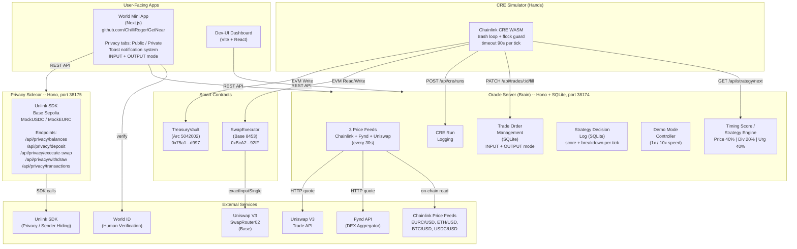

# System Architecture Overview

The full system map showing all components and their connections.

### ASCII Art

```
  ┌──────────────────────────────────────────────────────────────────────────────────────────┐
  │                              GetNear SYSTEM ARCHITECTURE                              │
  └──────────────────────────────────────────────────────────────────────────────────────────┘

  ┌─────────────────────────┐              ┌─────────────────────────┐
  │  World Mini App         │              │  Dev-UI Dashboard       │
  │  (Next.js)              │              │  (Vite + React)         │
  │  github.com/ChilliRoger/GetNear│              │       │
  │                         │              │                         │
  │  - Trade form + preview │              │  - Oracle readings live │
  │  - INPUT / OUTPUT mode  │              │  - CRE run history      │
  │  - Open trades list     │              │  - Next tick countdown  │
  │  - Fill % + progress    │              │  - Price comparison     │
  │  - World ID approval    │              │  - Strategy score       │
  │  - Clock overlay (1x/10x)             │  - Speed mode toggle    │
  │  - Real wallet balances │              │                         │
  │  - Toast notifications  │              │                         │
  │  - i18n (EN/FR)         │              │                         │
  │  - Privacy tabs:        │              │                         │
  │    Public / Private     │              │                         │
  │    trade + dashboard    │              │                         │
  └────────────┬────────────┘              └────────────┬────────────┘
               │  REST API                              │  REST API
               │                                        │
  ┌────────────┴────────────────────────────────────────┴────────────┐
  │                     ORACLE SERVER (Brain)                         │
  │                     Hono + SQLite, port 38174                     │
  │                                                                   │
  │  ┌───────────────┐  ┌───────────────┐  ┌───────────────────────┐ │
  │  │ 3 Price Feeds │  │ Trade Order   │  │ Timing Score /        │ │
  │  │               │  │ Management    │  │ Strategy Engine        │ │
  │  │ - Chainlink   │  │               │  │                       │ │
  │  │   (on-chain)  │  │ - Create      │  │ - Price vs 24h (40%)  │ │
  │  │ - Fynd API    │  │ - List/Filter │  │ - Divergence   (20%)  │ │
  │  │   (DEX agg)   │  │ - Approve     │  │ - Urgency      (40%)  │ │
  │  │ - Uniswap     │  │ - Cancel      │  │                       │ │
  │  │   Trade API   │  │ - Fill (CRE)  │  │ Score > 85: 2x chunk  │ │
  │  │               │  │ - INPUT mode  │  │ Score > 70: 1x chunk  │ │
  │  │ Every 30s     │  │ - OUTPUT mode │  │ Score < 70: WAIT      │ │
  │  └───────────────┘  │               │  │ Urgency > 80: forced  │ │
  │                     │ SQLite DB     │  └───────────────────────┘ │
  │  ┌───────────────┐  └───────────────┘  ┌───────────────────────┐ │
  │  │ Demo Mode     │  ┌───────────────┐  │ Strategy Decision Log │ │
  │  │ Controller    │  │ CRE Run Log   │  │                       │ │
  │  │               │  │               │  │ - strategy_decisions   │ │
  │  │ - Speed 1x/10x  │ - Tick history │  │   table (SQLite)      │ │
  │  │ - Seed data   │  │ - Actions     │  │ - Score + breakdown   │ │
  │  └───────────────┘  │ - Tx hashes   │  │ - Chunk amount/mult   │ │
  │                     └───────────────┘  │ - Persists per tick   │ │
  │                                        └───────────────────────┘ │
  └──────────────┬───────────────────────────────┬───────────────────┘
                 │                               │
    ┌────────────┴────────────┐     ┌────────────┴────────────────────────┐
    │                         │     │                                      │
    v                         v     v                                      │
  ┌──────────────────────────────┐  ┌─────────────────────────────┐       │
  │  CRE Simulator (Hands)      │  │  External Price Services     │       │
  │                              │  │                              │       │
  │  Chainlink CRE, WASM        │  │  ┌────────────────────────┐  │       │
  │                              │  │  │ Chainlink Price Feeds  │  │       │
  │  - Bash loop (flock guard)   │  │  │ EURC/USD, ETH/USD,    │  │       │
  │  - Compiles to WASM          │  │  │ BTC/USD, USDC/USD     │  │       │
  │  - Runs via `cre` binary     │  │  │ (on-chain, Base)       │  │       │
  │  - timeout 90s per tick      │  │  └────────────────────────┘  │       │
  │  - Logs to /tmp/cre-loop.log │  │  ┌────────────────────────┐  │       │
  │                              │  │  │ Fynd API               │  │       │
  │  Each tick:                  │  │  │ (DEX aggregator)       │  │       │
  │  GET Oracle strategy ->      │  │  └────────────────────────┘  │       │
  │  Execute on-chain ->         │  │  ┌────────────────────────┐  │       │
  │  Report back to Oracle       │  │  │ Uniswap V3 Trade API  │  │       │
  └───────────────┬──────────────┘  │  │ (spot price quotes)    │  │       │
                  │                 │  └────────────────────────┘  │       │
                  │                 └──────────────────────────────┘       │
                  │                                                        │
     ┌────────────┴─────────────────────────────────┐                     │
     │                                               │                    │
     v                                               v                    │
  ┌─────────────────────────────┐  ┌─────────────────────────────┐       │
  │  SwapExecutor               │  │  TreasuryVault              │       │
  │  (Base 8453)                │  │  (Arc 5042002)              │       │
  │                             │  │                              │       │
  │  0xBcA2...92fF              │  │  0x75a1...d997               │       │
  │                             │  │                              │       │
  │                             │  │                              │       │
  │  - executeSwap()            │  │  - getPolicy()               │       │
  │    calls Uniswap V3         │  │  - setPolicy()               │       │
  │    SwapRouter02             │  │  - logExecution()             │       │
  │  - executeReverseSwap()     │  │  - createPendingTrade()       │       │
  │  - withdraw() [owner|CRE]  │  │  - confirmApproval()          │       │
  │  - getBalances()            │  │  - rejectTrade()              │       │
  │                             │  │  - getActivePendingTrades()   │       │
  │  Pool fee: 0.05% (500)     │  │                              │       │
  │  MIN_TRADE: $1 (1e6)       │  │  Policy: threshold, rate band│       │
  │                             │  │  Audit: idempotent logging   │       │
  │  Uniswap V3 SwapRouter02:  │  │                              │       │
  │  0x2626...e481              │  │  Mock Tokens (Arc testnet): │       │
  │                             │  │    USDC: 0x4Fa3...BB7       │       │
  │                             │  │    EURC: 0xe022...D956      │       │
  └─────────────────────────────┘  └─────────────────────────────┘       │
                                                                          │
  ┌─────────────────────────────┐  ┌──────────────────────────────────────┘
  │  World ID                   │  │
  │  (Human Verification)       │  v
  │                             │  ┌─────────────────────────────┐
  │  - Verifies large trade     │  │  Privacy Sidecar Server     │
  │    approvals                │  │  (Hono, port 38175)         │
  │  - action: "approve-trade"  │  │                             │
  │  - signal: tradeId          │  │  - Unlink SDK integration   │
  │  - POST /api/verify-worldid │  │    (sender hiding)          │
  └─────────────────────────────┘  │  - Base Sepolia testnet     │
                                   │                             │
                                   │  Routes:                    │
                                   │  - /api/privacy/balances    │
                                   │  - /api/privacy/faucet      │
                                   │  - /api/privacy/deposit     │
                                   │  - /api/privacy/execute-swap│
                                   │  - /api/privacy/withdraw    │
                                   │  - /api/privacy/transactions│
                                   │  - /api/privacy/demo        │
                                   │                             │
                                   │  Mock Tokens (Base Sepolia):│
                                   │    MockUSDC + MockEURC      │
                                   └─────────────────────────────┘
```

### Mermaid


