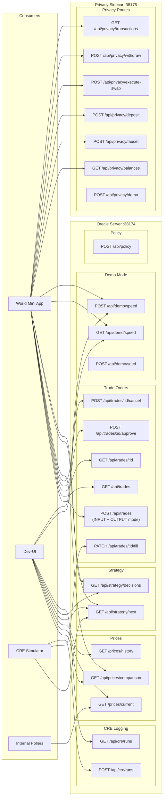

# API Endpoint Map

Every Oracle endpoint organized by consumer.

### ASCII Art

```
  ┌──────────────────────────────────────────────────────────────────────────────┐
  │                           ORACLE API ENDPOINT MAP                            │
  │                        http://localhost:38174                                 │
  └──────────────────────────────────────────────────────────────────────────────┘

  ═══════════════════════════════════════════════════════════════════════════════
  FRONTEND CALLS (World Mini App + Dev-UI)
  ═══════════════════════════════════════════════════════════════════════════════

  ┌──────────────────────────────┬──────────────────────────────────────────────┐
  │ Endpoint                     │ Description                                  │
  ├──────────────────────────────┼──────────────────────────────────────────────┤
  │ GET  /api/prices/comparison  │ 3-source prices + divergence bps + 24h avg  │
  │ GET  /api/trades             │ List trade orders (filter by ?status=)       │
  │ POST /api/trades             │ Create new trade order (INPUT or OUTPUT mode)│
  │ GET  /api/trades/:id         │ Single order detail with fill %             │
  │ POST /api/trades/:id/approve │ Mark approved (after World ID verification) │
  │ POST /api/trades/:id/cancel  │ Cancel an order                             │
  │ GET  /api/strategy/next      │ Current timing score + decision + breakdown │
  │ GET  /api/strategy/decisions │ Strategy decision history log (?limit=N,    │
  │                              │   ?order_id=X). Persisted per tick w/ score,│
  │                              │   breakdown, chunk_amount, chunk_multiplier │
  │ GET  /api/demo/speed         │ Read demo speed { speed: 1|10, sleep: 55|5 }│
  │ POST /api/demo/speed         │ Toggle demo speed (DEMO_MODE only)          │
  │ POST /api/demo/seed          │ Seed demo orders (DEMO_MODE only)           │
  │ GET  /api/cre/runs           │ CRE execution history (?limit=N)            │
  │ POST /api/policy             │ Update on-chain policy (writes to Arc)       │
  └──────────────────────────────┴──────────────────────────────────────────────┘

  ═══════════════════════════════════════════════════════════════════════════════
  CRE CALLS (Simulator workflow -> Oracle)
  ═══════════════════════════════════════════════════════════════════════════════

  ┌──────────────────────────────┬──────────────────────────────────────────────┐
  │ Endpoint                     │ Description                                  │
  ├──────────────────────────────┼──────────────────────────────────────────────┤
  │ GET  /api/strategy/next      │ What should CRE do this tick?               │
  │                              │ Returns: { action, orderId, chunkAmount,    │
  │                              │   minOutput, score, reason, breakdown }     │
  ├──────────────────────────────┼──────────────────────────────────────────────┤
  │ PATCH /api/trades/:id/fill   │ Report fill (idempotent by txHash)          │
  │                              │ Body: { filledAmount, outputReceived,       │
  │                              │   status, txHash }                          │
  ├──────────────────────────────┼──────────────────────────────────────────────┤
  │ POST /api/cre/runs           │ Log tick result                             │
  │                              │ Body: { startedAt, action, orderId,         │
  │                              │   chunkAmount, result, txHash, durationMs } │
  └──────────────────────────────┴──────────────────────────────────────────────┘

  ═══════════════════════════════════════════════════════════════════════════════
  PRIVACY SIDECAR ENDPOINTS (port 38175)
  ═══════════════════════════════════════════════════════════════════════════════

  ┌──────────────────────────────┬──────────────────────────────────────────────┐
  │ Endpoint                     │ Description                                  │
  ├──────────────────────────────┼──────────────────────────────────────────────┤
  │ GET  /health                 │ Health + Unlink SDK configuration status    │
  │ GET  /api/privacy/balances   │ MockUSDC + MockEURC balances (Base Sepolia) │
  │ POST /api/privacy/faucet     │ Mint test tokens (MockUSDC/MockEURC)        │
  │ POST /api/privacy/deposit    │ Deposit into Unlink privacy pool            │
  │ POST /api/privacy/execute-swap│ Private swap via Unlink                    │
  │ POST /api/privacy/withdraw   │ Withdraw from Unlink privacy pool           │
  │ GET  /api/privacy/transactions│ Private transaction history                │
  │ POST /api/privacy/demo       │ Demo mode operations                        │
  └──────────────────────────────┴──────────────────────────────────────────────┘

  ═══════════════════════════════════════════════════════════════════════════════
  PRICE POLLERS (Internal, every 30s)
  ═══════════════════════════════════════════════════════════════════════════════

  ┌──────────────────────────────┬──────────────────────────────────────────────┐
  │ Source                       │ Details                                      │
  ├──────────────────────────────┼──────────────────────────────────────────────┤
  │ Chainlink Price Feeds        │ 4 pairs via on-chain reads (Base):          │
  │                              │   EURC/USD  0xDAe3...8250                   │
  │                              │   ETH/USD   0x7104...d3B70                  │
  │                              │   BTC/USD   0xCCAD...92fE                   │
  │                              │   USDC/USD  0x7e86...6B                     │
  ├──────────────────────────────┼──────────────────────────────────────────────┤
  │ Fynd API                     │ DEX aggregator quote (EURC/USD only)        │
  │                              │ POST /v1/quote, 10000 USDC input            │
  ├──────────────────────────────┼──────────────────────────────────────────────┤
  │ Uniswap V3 Trade API        │ Spot price quote (EURC/USD only)            │
  │                              │ POST trade-api.gateway.uniswap.org          │
  │                              │ 1 USDC EXACT_INPUT                          │
  └──────────────────────────────┴──────────────────────────────────────────────┘

  ═══════════════════════════════════════════════════════════════════════════════
  LEGACY / ADDITIONAL ENDPOINTS
  ═══════════════════════════════════════════════════════════════════════════════

  ┌──────────────────────────────┬──────────────────────────────────────────────┐
  │ Endpoint                     │ Description                                  │
  ├──────────────────────────────┼──────────────────────────────────────────────┤
  │ GET  /health                 │ Health check: feed count + recording count  │
  │ GET  /prices/current         │ Latest price per pair (all feeds)           │
  │ GET  /prices/history         │ Time series (?pair=&hours=)                 │
  │ GET  /depth                  │ Fynd depth curve (?sell_token=&buy_token=)  │
  │ GET  /depth/book             │ Bid/ask order book (?base=&quote=)          │
  └──────────────────────────────┴──────────────────────────────────────────────┘
```

### Mermaid


