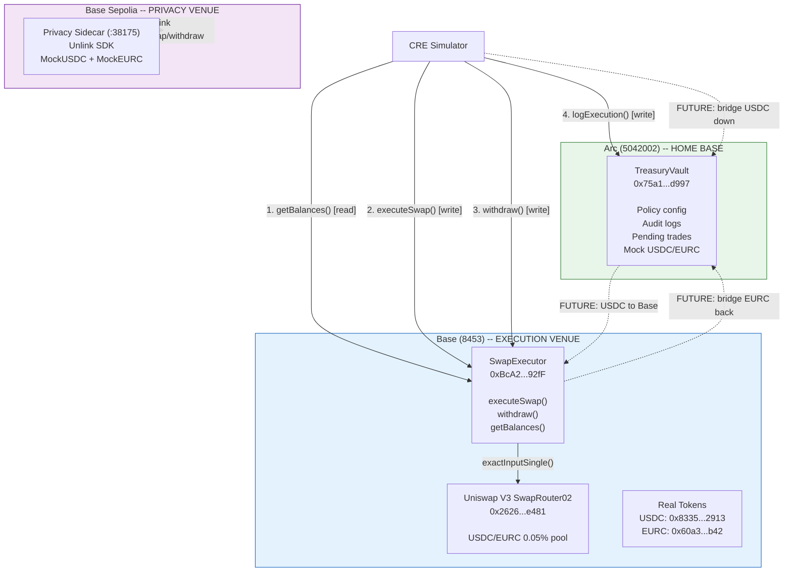

# Multi-Chain Flow with Bridging (Optimistic)

Data and value flow across Base and Arc chains.

### ASCII Art

```
  ┌──────────────────────────────────────────────────────────────────────────────┐
  │                     MULTI-CHAIN ARCHITECTURE: Arc + Base                     │
  └──────────────────────────────────────────────────────────────────────────────┘

  ┌───────────────────────────────────────────┐
  │         ARC (Chain 5042002)               │
  │         "HOME BASE" -- Security + Audit   │
  │                                           │
  │  ┌─────────────────────────────────────┐  │
  │  │  TreasuryVault                      │  │
  │  │  0x75a1...d997                               │
  │  │                                     │  │
  │  │  Policy:                            │  │
  │  │    autoExecuteThreshold: $10K       │  │
  │  │    targetRateMin: 1.07 (18 dec)     │  │
  │  │    targetRateMax: 1.09 (18 dec)     │  │
  │  │                                     │  │
  │  │  Audit Log:                         │  │
  │  │    logExecution() per trade         │  │
  │  │    idempotent (executionLogged map) │  │
  │  │                                     │  │
  │  │  Pending Trades:                    │  │
  │  │    createPendingTrade() by CRE      │  │
  │  │    confirmApproval() by CFO         │  │
  │  │    rejectTrade() by CFO             │  │
  │  │                                     │  │
  │  │  Mock Tokens (Arc testnet):          │  │
  │  │    USDC: 0x4Fa3...BB7                           │
  │  │    EURC: 0xe022...D956                          │
  │  └─────────────────────────────────────┘  │
  └────────────────────┬──────────────────────┘
                       │
                       │  CURRENT: CRE writes logExecution()
                       │           CRE reads getPolicy()
                       │
                       │  FUTURE:  Bridge USDC down (pre-swap)
                       │           Bridge EURC back (post-swap)
                       │
  ─ ─ ─ ─ ─ ─ ─ ─ ─ ─┼─ ─ ─ ─ ─ ─ ─ ─ ─ ─ ─ ─ ─ ─ ─ ─ ─ ─
                       │
  ┌────────────────────┴──────────────────────┐
  │         BASE (Chain 8453)                 │
  │         "EXECUTION VENUE" -- Transient    │
  │                                           │
  │  ┌─────────────────────────────────────┐  │
  │  │  SwapExecutor                       │  │
  │  │  0xBcA2...92fF                               │
  │  │                                     │  │
  │  │  Holds funds DURING execution:      │  │
  │  │    USDC -> executeSwap() -> EURC    │  │
  │  │    withdraw() sends to owner        │  │
  │  │                                     │  │
  │  │  Access: onlyCRE (KeystoneForwarder)│  │
  │  │  Pool fee: 500 (0.05%)              │  │
  │  │  MIN_TRADE: $1 (1e6)               │  │
  │  └──────────────────┬──────────────────┘  │
  │                     │                      │
  │                     v                      │
  │  ┌─────────────────────────────────────┐  │
  │  │  Uniswap V3 SwapRouter02           │  │
  │  │  0x2626664c2603336E57B2...e481      │  │
  │  │                                     │  │
  │  │  USDC/EURC Pool (0.05% fee tier)   │  │
  │  │  exactInputSingle()                 │  │
  │  └─────────────────────────────────────┘  │
  │                                           │
  │  Real Tokens (mainnet):                   │
  │    USDC: 0x8335...2913                    │
  │    EURC: 0x60a3...b42                     │
  │    WETH: 0x4200...0006                    │
  └───────────────────────────────────────────┘

  ═══════════════════════════════════════════════════════════════════
  CURRENT FLOW (implemented):
  ═══════════════════════════════════════════════════════════════════

  PUBLIC TREASURY PATH:
  1. User transfers USDC to SwapExecutor on Base
  2. CRE calls executeSwap() on Base (Uniswap V3)
  3. CRE calls withdraw() on Base -> tokens to treasury wallet
  4. CRE calls logExecution() on Arc -> audit trail

  PRIVATE TREASURY PATH (Base Sepolia):
  1. User deposits MockUSDC/MockEURC via Privacy Sidecar (:38175)
  2. Sidecar calls Unlink SDK to shield sender
  3. Private swap executed through Unlink
  4. User withdraws from privacy pool

  ═══════════════════════════════════════════════════════════════════
  FUTURE/OPTIMISTIC FLOW (not yet implemented):
  ═══════════════════════════════════════════════════════════════════

  1. CRE bridges USDC from Arc TreasuryVault -> Base SwapExecutor
  2. CRE calls executeSwap() on Base (Uniswap V3)
  3. CRE calls withdraw() EURC from SwapExecutor
  4. CRE bridges EURC from Base -> Arc TreasuryVault
  5. Treasury always lives on Arc; Base is transient execution only
```

### Mermaid


