# Sponsor Integration Map

Which sponsor technologies are used and where they integrate.

### ASCII Art

```
  ┌──────────────────────────────────────────────────────────────────────────────┐
  │                        SPONSOR INTEGRATION MAP                               │
  └──────────────────────────────────────────────────────────────────────────────┘


  ┌─────────────────────────────────────────────────────────────────────────┐
  │  CHAINLINK                                                              │
  │                                                                         │
  │  1. CRE (Compute Runtime Environment)                                   │
  │     ├── Orchestration engine for the entire execution loop              │
  │     ├── WASM workflow compiled from TypeScript (workflow.ts)            │
  │     ├── CronCapability: scheduled trigger                               │
  │     ├── HTTPClient: Oracle API calls with consensus aggregation        │
  │     ├── EVMClient: on-chain reads/writes with report signing           │
  │     └── KeystoneForwarder: trusted on-chain relay (onlyCRE modifier)   │
  │                                                                         │
  │  2. Price Feeds (On-Chain, Base)                                        │
  │     ├── EURC/USD  0xDAe3...8250                                       │
  │     ├── EUR/USD   (derived from EURC/USD)                               │
  │     ├── USDC/USD  0x7e86...c6B                                        │
  │     └── ETH/USD   0x7104...Bb70                                       │
  │         (recorded every 30s by Oracle, used in timing score)            │
  └─────────────────────────────────────────────────────────────────────────┘

  ┌─────────────────────────────────────────────────────────────────────────┐
  │  UNISWAP                                                                │
  │                                                                         │
  │  1. V3 SwapRouter02 (On-Chain Execution, Base)                          │
  │     ├── Contract: 0x2626...e481                                         │
  │     ├── USDC/EURC pool, 0.05% fee tier (500)                           │
  │     ├── exactInputSingle() called by SwapExecutor                      │
  │     └── Real mainnet swaps with slippage protection                    │
  │                                                                         │
  │  2. Trade API (Off-Chain Price Quotes)                                  │
  │     ├── https://trade-api.gateway.uniswap.org/v1/quote                 │
  │     ├── Polled every 30s for EURC/USD spot price                       │
  │     └── One of 3 inputs to the timing score calculator                 │
  └─────────────────────────────────────────────────────────────────────────┘

  ┌─────────────────────────────────────────────────────────────────────────┐
  │  ARC (Circle L1)                                                        │
  │                                                                         │
  │  1. TreasuryVault (On-Chain, Arc Testnet 5042002)                       │
  │     ├── Policy engine: auto-execute threshold + rate band              │
  │     ├── Audit trail: logExecution() with idempotency guard             │
  │     ├── Approval gate: createPendingTrade() + confirmApproval()        │
  │     └── CFO access control: multi-role (owner, CFO, CRE)              │
  │                                                                         │
  │  2. Cross-Chain Treasury (Future/Optimistic)                            │
  │     ├── Idle funds stored on Arc (security layer)                      │
  │     ├── Bridge to Base only for active swap execution                  │
  │     └── Bridge back after swap completes                               │
  └─────────────────────────────────────────────────────────────────────────┘

  ┌─────────────────────────────────────────────────────────────────────────┐
  │  WORLD (Worldcoin)                                                      │
  │                                                                         │
  │  1. World ID (Human Verification)                                       │
  │     ├── Large trade approvals require World ID proof                   │
  │     ├── Mini App hosted as World App integration                       │
  │     ├── action: "approve-trade", signal: tradeId                       │
  │     └── POST /api/verify-worldid from approve page                     │
  │                                                                         │
  │  2. World Mini App Platform                                             │
  │     ├── meridian.omnipass.world served as World Mini App               │
  │     └── Mobile-first UX inside World App ecosystem                     │
  └─────────────────────────────────────────────────────────────────────────┘

  ┌─────────────────────────────────────────────────────────────────────────┐
  │  UNLINK (Active -- Privacy Sidecar)                                     │
  │                                                                         │
  │  1. Privacy Sidecar Server (port 38175)                                 │
  │     ├── @unlink-xyz/sdk integration for sender hiding                  │
  │     ├── Deposit USDC/EURC into Unlink privacy pool                     │
  │     ├── Execute private swaps (shielded sender)                        │
  │     ├── Withdraw from privacy pool                                     │
  │     └── Transaction history with privacy status                        │
  │                                                                         │
  │  2. Base Sepolia Testnet                                                │
  │     ├── MockUSDC + MockEURC test tokens                                │
  │     ├── Faucet endpoint for testnet tokens                             │
  │     └── Demo mode for hackathon presentation                           │
  │                                                                         │
  │  3. Frontend Integration                                                │
  │     ├── Privacy tabs on Trade + Dashboard pages                        │
  │     ├── PrivateSwapForm component                                      │
  │     ├── PrivacyComparison (public vs private)                          │
  │     ├── PrivacyTxHistory + PrivacyDashboard                            │
  │     └── Side-by-side public/private treasury views                     │
  └─────────────────────────────────────────────────────────────────────────┘
```

### Mermaid

```mermaid
graph TB
    subgraph System ["Meridian FX System"]
        Oracle["Oracle Server<br/>(Brain)"]
        CRE["CRE Simulator<br/>(Hands)"]
        SE["SwapExecutor<br/>(Base)"]
        TV["TreasuryVault<br/>(Arc)"]
        App["World Mini App<br/>(Frontend)"]
    end

    subgraph Chainlink ["CHAINLINK"]
        CRE_Engine["CRE Engine<br/>WASM orchestration<br/>CronCapability<br/>HTTPClient + EVMClient"]
        PriceFeeds["On-Chain Price Feeds<br/>EURC/USD, USDC/USD<br/>ETH/USD, BTC/USD"]
        KSF["KeystoneForwarder<br/>(trusted relay)"]
    end

    subgraph Uniswap ["UNISWAP"]
        Router["V3 SwapRouter02<br/>USDC/EURC 0.05% pool<br/>exactInputSingle()"]
        TradeAPI["Trade API<br/>Spot price quotes<br/>(every 30s)"]
    end

    subgraph ArcChain ["ARC (Circle L1)"]
        Policy["Policy Engine<br/>threshold + rate band"]
        Audit["Audit Trail<br/>logExecution()"]
        Approval["Approval Gate<br/>createPendingTrade()"]
    end

    subgraph World ["WORLD"]
        WorldID["World ID<br/>Human verification<br/>for large trades"]
        MiniApp["Mini App Platform<br/>meridian.omnipass.world"]
    end

    subgraph UnlinkBox ["UNLINK (Active)"]
        Unlink["Unlink SDK<br/>Privacy sidecar (:38175)<br/>Sender hiding<br/>Base Sepolia testnet"]
        PrivacyUI["Privacy tabs<br/>in World Mini App<br/>Public / Private views"]
    end

    CRE_Engine -->|orchestrates| CRE
    PriceFeeds -->|"ground truth (30s)"| Oracle
    KSF -->|"onlyCRE modifier"| SE
    KSF -->|"onlyCRE modifier"| TV

    Router -->|swap execution| SE
    TradeAPI -->|"spot price (30s)"| Oracle

    Policy --> TV
    Audit --> TV
    Approval --> TV

    WorldID -->|verify approval| App
    MiniApp -->|hosts| App

    Unlink -->|"@unlink-xyz/sdk"| App
    PrivacyUI -->|"privacy tabs"| App

    style Chainlink fill:#375BD2,color:#fff
    style Uniswap fill:#FF007A,color:#fff
    style ArcChain fill:#00D395,color:#fff
    style World fill:#191919,color:#fff
    style UnlinkBox fill:#6C3483,color:#fff
```


