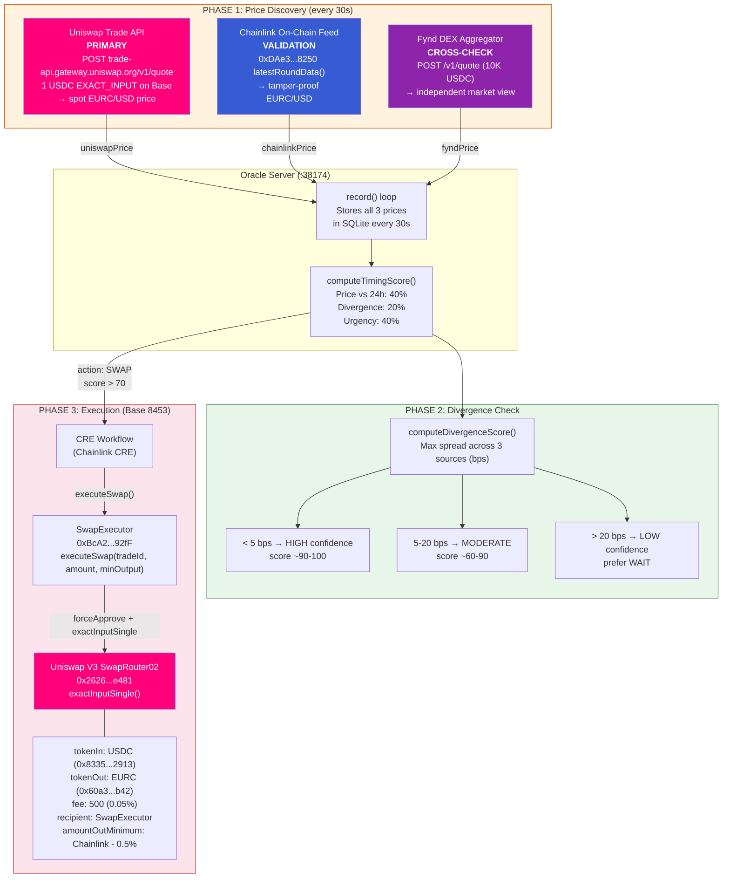

# Uniswap Integration Deep-Dive

How Meridian FX uses Uniswap as **both** the primary price oracle **and** the
execution venue. Chainlink validates; Fynd cross-checks; Uniswap executes.

### ASCII Art

```
  ┌──────────────────────────────────────────────────────────────────────────────┐
  │                     UNISWAP INTEGRATION DEEP-DIVE                           │
  │             "Uniswap is BOTH our price oracle AND our execution venue.       │
  │              Chainlink validates. Fynd cross-checks. Uniswap executes."      │
  └──────────────────────────────────────────────────────────────────────────────┘


  ═══════════════════════════════════════════════════════════════════════════════
  PHASE 1: PRICE DISCOVERY  (Oracle polls every 30s)
  ═══════════════════════════════════════════════════════════════════════════════

  ┌─────────────────────────────────────────────────────────────────────────────┐
  │                          Oracle Server (:38174)                             │
  │                          record() loop, 30s interval                        │
  │                                                                             │
  │  ┌───────────────────────────────────────────────────────────────────────┐  │
  │  │  SOURCE 1 (PRIMARY): Uniswap Trade API                               │  │
  │  │                                                                       │  │
  │  │  POST https://trade-api.gateway.uniswap.org/v1/quote                 │  │
  │  │  Headers: x-api-key: $UNISWAP_API_KEY                                │  │
  │  │  Body:                                                                │  │
  │  │    tokenInChainId:  8453 (Base)                                       │  │
  │  │    tokenIn:   0x8335...2913 (USDC)                                    │  │
  │  │    tokenOut:  0x60a3...b42 (EURC)                                     │  │
  │  │    amount:    1000000 (1 USDC, EXACT_INPUT)                           │  │
  │  │                                                                       │  │
  │  │  Response: quote.output.amount / quote.input.amount -> EURC per USDC  │  │
  │  │  Invert to get USD/EURC (= EURC/USD price)                           │  │
  │  │                                                                       │  │
  │  │  Role: Primary spot price + execution venue preview                   │  │
  │  │  Timeout: 8s  |  Fallback: null (skipped gracefully)                  │  │
  │  └───────────────────────────────────────────────────────────────────────┘  │
  │                                                                             │
  │  ┌───────────────────────────────────────────────────────────────────────┐  │
  │  │  SOURCE 2 (VALIDATION): Chainlink On-Chain Price Feed                 │  │
  │  │                                                                       │  │
  │  │  Contract: 0xDAe3...8250 (Base)                                      │  │
  │  │  Call: latestRoundData() -> answer / 10^decimals = EURC/USD           │  │
  │  │                                                                       │  │
  │  │  Role: Tamper-proof ground truth. If Uniswap price diverges from      │  │
  │  │        Chainlink beyond tolerance, confidence drops.                   │  │
  │  │  Also: Sets the floor for amountOutMinimum (slippage protection).     │  │
  │  └───────────────────────────────────────────────────────────────────────┘  │
  │                                                                             │
  │  ┌───────────────────────────────────────────────────────────────────────┐  │
  │  │  SOURCE 3 (CROSS-CHECK): Fynd DEX Aggregator                         │  │
  │  │                                                                       │  │
  │  │  POST $FYND_URL/v1/quote                                              │  │
  │  │  Body: 10000 USDC sell -> EURC, timeout 5s                            │  │
  │  │  Response: amount_out / amount_in -> EURC per USDC -> invert          │  │
  │  │                                                                       │  │
  │  │  Role: Independent market view from aggregated DEX routes.            │  │
  │  │        Confirms Uniswap isn't an outlier.                              │  │
  │  └───────────────────────────────────────────────────────────────────────┘  │
  │                                                                             │
  │  All 3 prices stored: prices table (chainlink_price, fynd_price,           │
  │                                     uniswap_price) per 30s tick            │
  └─────────────────────────────────────────────────────────────────────────────┘
                                       │
                                       ▼

  ═══════════════════════════════════════════════════════════════════════════════
  PHASE 2: DIVERGENCE CHECK  (strategy.ts — computeDivergenceScore)
  ═══════════════════════════════════════════════════════════════════════════════

  ┌─────────────────────────────────────────────────────────────────────────────┐
  │  Input: [chainlinkPrice, fyndPrice, uniswapPrice]                          │
  │                                                                             │
  │  Max spread = ((max - min) / avg) * 10,000 bps                             │
  │                                                                             │
  │  ┌──────────────────┬───────────────────────────────────────────────────┐   │
  │  │  Spread (bps)    │  Confidence       │  Score Contribution           │   │
  │  ├──────────────────┼───────────────────────────────────────────────────┤   │
  │  │  < 5 bps         │  HIGH  (green)    │  divergenceScore ~ 90-100     │   │
  │  │  5-20 bps        │  MODERATE (yellow)│  divergenceScore ~ 60-90      │   │
  │  │  > 20 bps        │  LOW  (red)       │  divergenceScore < 60         │   │
  │  │  > 50 bps        │  NONE             │  divergenceScore = 0          │   │
  │  └──────────────────┴───────────────────────────────────────────────────┘   │
  │                                                                             │
  │  Divergence weight in composite score: 20%                                 │
  │  (Price vs 24h avg: 40%  |  Urgency: 40%  |  Divergence: 20%)             │
  │                                                                             │
  │  Composite score thresholds:                                               │
  │    > 85 → SWAP aggressive (2x chunk)                                       │
  │    > 70 → SWAP normal chunk                                                │
  │    < 70 → WAIT (unless urgency > 80, then force)                           │
  └─────────────────────────────────────────────────────────────────────────────┘
                                       │
                                       ▼  If action = SWAP

  ═══════════════════════════════════════════════════════════════════════════════
  PHASE 3: EXECUTION  (CRE calls SwapExecutor on Base 8453)
  ═══════════════════════════════════════════════════════════════════════════════

  ┌─────────────────────────────────────────────────────────────────────────────┐
  │  CRE Workflow                                                               │
  │  ┌───────────────────────────────────────────────────────────────────────┐  │
  │  │  1. GET /api/strategy/next -> { action: SWAP, orderId, chunkAmount, │  │
  │  │     minOutput }                                                      │  │
  │  │                                                                       │  │
  │  │  2. SwapExecutor.executeSwap(tradeId, amountIn, amountOutMinimum)    │  │
  │  │     Contract: 0xBcA2...92fF (Base)                                  │  │
  │  │     Access: onlyCRE (KeystoneForwarder only)                         │  │
  │  └───────────────┬───────────────────────────────────────────────────────┘  │
  │                   │                                                         │
  │                   ▼                                                         │
  │  ┌───────────────────────────────────────────────────────────────────────┐  │
  │  │  SwapExecutor internals:                                              │  │
  │  │                                                                       │  │
  │  │  a. Verify _amountIn >= MIN_TRADE_AMOUNT ($1 = 1e6)                  │  │
  │  │  b. Check USDC balance >= _amountIn                                   │  │
  │  │  c. IERC20(USDC).forceApprove(uniswapRouter, _amountIn)             │  │
  │  │  d. Call Uniswap V3 SwapRouter02.exactInputSingle():                 │  │
  │  │                                                                       │  │
  │  │     ┌─────────────────────────────────────────────────────────────┐   │  │
  │  │     │  ISwapRouter.ExactInputSingleParams                        │   │  │
  │  │     │                                                             │   │  │
  │  │     │  tokenIn:          0x8335...2913 (USDC)                        │  │
  │  │     │                    (USDC on Base)                           │   │  │
  │  │     │  tokenOut:         0x60a3...b42 (EURC)                         │  │
  │  │     │                    (EURC on Base)                           │   │  │
  │  │     │  fee:              500 (0.05% pool — stablecoin tier)       │   │  │
  │  │     │  recipient:        address(this) — SwapExecutor contract    │   │  │
  │  │     │  amountIn:         _amountIn (from CRE strategy)           │   │  │
  │  │     │  amountOutMinimum: _amountOutMinimum                       │   │  │
  │  │     │                    (Chainlink price - 0.5% slippage buffer) │   │  │
  │  │     │  sqrtPriceLimitX96: 0 (no price limit)                     │   │  │
  │  │     └─────────────────────────────────────────────────────────────┘   │  │
  │  │                                                                       │  │
  │  │  e. Emit SwapExecuted(tradeId, USDC, EURC, amountIn, amountOut, ts) │  │
  │  │  f. Return amountOut to CRE                                          │  │
  │  └───────────────────────────────────────────────────────────────────────┘  │
  │                                                                             │
  │  Uniswap V3 SwapRouter02: 0x2626...e481                                    │
  │  Pool: USDC/EURC 0.05% fee tier on Base                                    │
  └─────────────────────────────────────────────────────────────────────────────┘

  ═══════════════════════════════════════════════════════════════════════════════
  SUMMARY: UNISWAP'S DUAL ROLE
  ═══════════════════════════════════════════════════════════════════════════════

  ┌─────────────────────────────────┬───────────────────────────────────────────┐
  │  Role                           │  How                                      │
  ├─────────────────────────────────┼───────────────────────────────────────────┤
  │  PRICE ORACLE (off-chain)       │  Trade API polled every 30s for spot      │
  │                                 │  quote: 1 USDC -> ? EURC                  │
  │                                 │  Used alongside Chainlink + Fynd in       │
  │                                 │  timing score (strategy.ts)               │
  ├─────────────────────────────────┼───────────────────────────────────────────┤
  │  EXECUTION VENUE (on-chain)     │  V3 SwapRouter02.exactInputSingle()       │
  │                                 │  called by SwapExecutor on Base            │
  │                                 │  USDC/EURC 0.05% pool, slippage from      │
  │                                 │  Chainlink ground truth                    │
  ├─────────────────────────────────┼───────────────────────────────────────────┤
  │  Chainlink role                 │  VALIDATION: tamper-proof ground truth     │
  │                                 │  Sets amountOutMinimum floor               │
  ├─────────────────────────────────┼───────────────────────────────────────────┤
  │  Fynd role                      │  CROSS-CHECK: independent DEX aggregator  │
  │                                 │  Confirms Uniswap isn't an outlier         │
  └─────────────────────────────────┴───────────────────────────────────────────┘
```

### Mermaid


